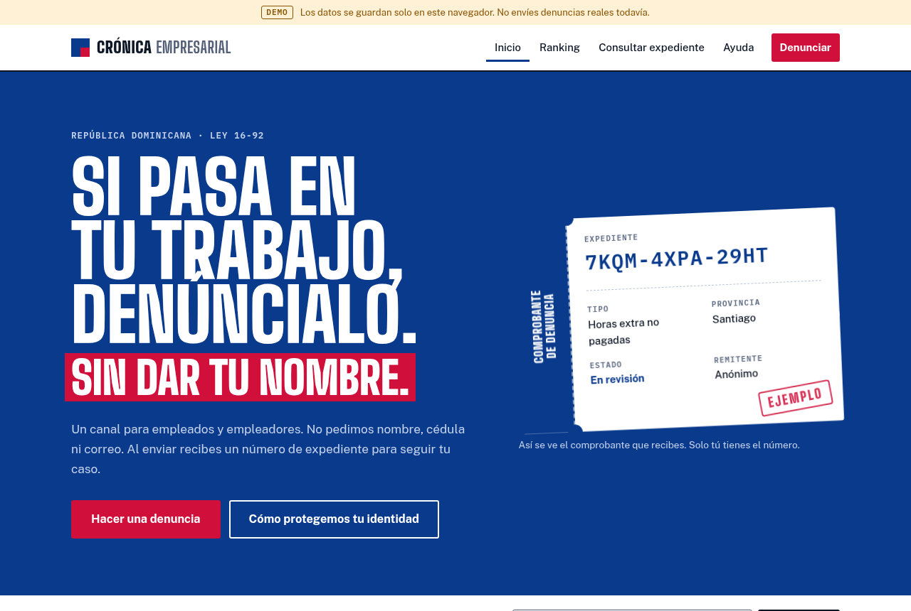
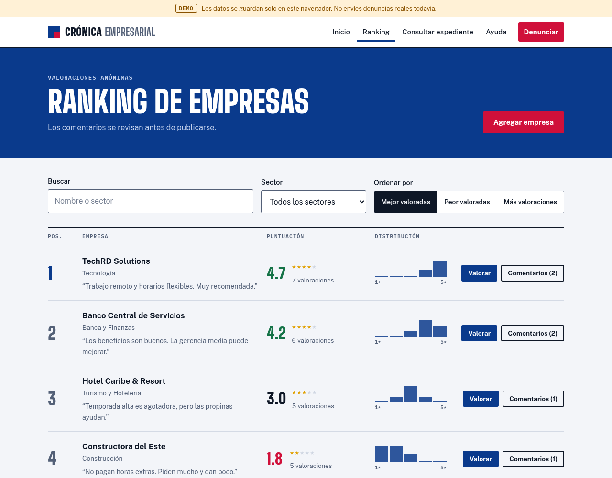

<div align="center">

# Crónica Empresarial

**Canal anónimo de denuncias laborales para la República Dominicana**

Para empleados y empleadores. Sin nombre, sin cédula, sin correo.

[**Ver la demo en vivo →**](https://c4ndido.github.io/denuncias-laborales/)




</div>

> [!WARNING]
> **Esta es una versión de demostración.** Todavía no hay servidor: los datos se guardan solo en el navegador de cada visitante y las denuncias no llegan a nadie. No envíes denuncias reales hasta que el backend esté listo.

## ¿Qué es?

Crónica Empresarial permite reportar situaciones laborales injustas sin revelar la identidad de quien denuncia. Al enviar una denuncia, la persona recibe un **número de expediente** aleatorio con el que puede consultar el estado de su caso más adelante. Así funcionan los canales de denuncia profesionales.

También incluye un **ranking público de empresas** con valoraciones anónimas de 1 a 5 estrellas.

## Funcionalidades

| | Estado |
|---|---|
| Formulario de denuncia en 4 pasos (empleado o empleador) | ✅ |
| Las 32 provincias y categorías basadas en el Código de Trabajo (Ley 16-92) | ✅ |
| Número de expediente y página para consultar el caso | ✅ |
| Ranking de empresas con búsqueda, filtro por sector y distribución de votos | ✅ |
| Autorización opcional para publicar una versión anónima en Instagram (sector y región, sin empresa) | ✅ |
| Preguntas frecuentes y enlaces al Ministerio de Trabajo y la TSS | ✅ |
| Diseño adaptado a celular y modo oscuro automático | ✅ |
| Backend con base de datos (Flask + SQLite) | 🚧 En desarrollo |
| Panel de moderación con login | 🚧 Planificado |
| Cifrado de denuncias en el servidor | 🚧 Planificado |

## Seguridad y privacidad

El proyecto se construye pensando primero en proteger a quien denuncia.

- **Protección contra XSS:** todo el texto que escriben los usuarios se escapa antes de mostrarse (función `esc()` en `js/main.js`). Un nombre de empresa como `` se muestra como texto y no se ejecuta.
- **Números de expediente impredecibles:** se generan con `crypto.getRandomValues()` (60 bits aleatorios), no con `Math.random()`, que es predecible. El alfabeto omite caracteres confusos como `0/O` y `1/I`.
- **El número nunca va en la URL**, para que no quede guardado en el historial del navegador.
- **Ninguna petición a terceros:** las fuentes están alojadas en el propio proyecto (`fonts/`), sin Google Fonts ni CDNs, así que la IP del visitante no se comparte con nadie. Además se usa `referrer: no-referrer`.
- **Aviso sobre metadatos:** el formulario advierte que las fotos pueden contener la ubicación GPS del teléfono.
- **Moderación:** los comentarios nuevos del ranking quedan pendientes y no se publican automáticamente.
- **Publicaciones en Instagram solo con permiso:** se muestran el tipo de situación, el sector y la región (Gran Santo Domingo, Norte, Sur o Este), nunca la empresa ni la provincia exacta, para que la combinación sector + lugar no delate a nadie.

## Capturas



## Probarlo en tu computadora

No necesita instalar nada más que Python, que se usa como servidor local.

```bash
git clone https://github.com/C4ndido/denuncias-laborales.git
cd denuncias-laborales
python3 -m http.server 8000
```

Luego abre <http://localhost:8000> en el navegador.

## Estructura

```
denuncias-laborales/
├── index.html        # Todas las vistas: inicio, denuncia, consulta, ranking y ayuda
├── css/
│   ├── styles.css    # Estilos y tema claro/oscuro
│   └── fonts.css     # Declaración de las fuentes locales
├── fonts/            # Big Shoulders Display, Public Sans e IBM Plex Mono (licencia OFL)
├── js/
│   └── main.js       # Navegación, formulario, ranking y almacenamiento demo
└── docs/             # Capturas para este README
```

## Hoja de ruta

- [x] Rediseño completo del frontend
- [x] Corrección de XSS y del envío del formulario de empresas
- [x] Publicación de la demo en GitHub Pages
- [ ] Backend en Flask con SQLite
- [ ] Panel de moderación con autenticación en dos pasos
- [ ] Cifrado de denuncias y eliminación de metadatos de archivos
- [ ] Cabeceras de seguridad (CSP, HSTS) y límite de intentos
- [ ] Términos de uso y política de privacidad (Ley 172-13)
- [ ] Pentest propio documentado

## Aviso legal

Crónica Empresarial es un proyecto comunitario y **no es un organismo oficial**. No reemplaza una denuncia formal. Para reclamar derechos laborales, acude al [Ministerio de Trabajo](https://mt.gob.do) o a un abogado laboral.

## Contribuir

Las sugerencias y reportes de errores son bienvenidos en [Issues](https://github.com/C4ndido/denuncias-laborales/issues). Si quieres aportar código, crea una rama, haz tus cambios y abre un Pull Request.

## Autor

Desarrollado por [@C4ndido](https://github.com/C4ndido), estudiante de ciberseguridad.

## Licencia

Distribuido bajo la licencia MIT. Consulta el archivo [LICENSE](LICENSE).
